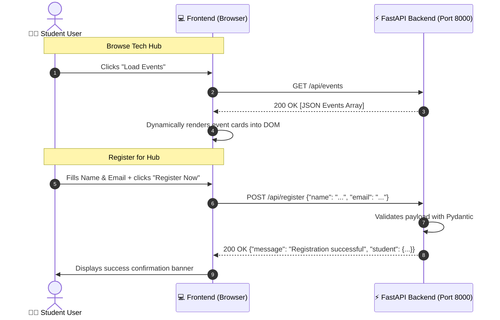

<div align="center">

# 🎓 Student Tech Hub

### *Empowering Student Developers Through Modern Full-Stack Web Architecture*

[](https://www.python.org/)
[](https://fastapi.tiangolo.com/)
[](https://developer.mozilla.org/en-US/docs/Web/JavaScript)
[](https://developer.mozilla.org/en-US/docs/Web/HTML)
[](https://developer.mozilla.org/en-US/docs/Web/CSS)
[](http://127.0.0.1:8000/docs)

<p align="center">
  <b>A clean, lightning-fast full-stack web application illustrating seamless frontend-to-backend communication.</b><br>
  Built with pure <b>Vanilla JavaScript</b> & modern <b>CSS Grid/Flexbox</b> on the frontend, and <b>FastAPI + Pydantic</b> on the backend.
</p>

[✨ Key Features](#-key-features) •
[🏗️ Architecture](#️-system-architecture) •
[⚡ Quick Start](#-quick-start-guide) •
[🔌 API Documentation](#-api-endpoints--schemas) •
[💡 Under the Hood](#-under-the-hood-deep-dive) •
[📂 Project Structure](#-project-structure)

---

</div>

## 🌟 Overview

**Student Tech Hub** is an open-source, beginner-friendly educational full-stack web application. It demonstrates how a decoupled client-side web application communicates asynchronously with a high-performance Python REST API via HTTP requests and JSON data payloads.

No heavy JavaScript frameworks, no complicated build pipelines, and no database setup required — just clean, elegant, readable code designed to help you master full-stack web fundamentals.

---

## ✨ Key Features

| Feature | Description |
| :--- | :--- |
| ⚡ **FastAPI Backend** | High-performance Python backend serving JSON endpoints with automatic data serialization and auto-generated Swagger UI. |
| 🛡️ **Pydantic Validation** | Automatic request parsing, strict type checking, and human-friendly error handling for registration payloads. |
| 🎨 **Responsive UI** | Pure modern CSS using custom properties (variables), Flexbox, and CSS Grid — fully responsive across mobile, tablet, and desktop. |
| 🔄 **Asynchronous Fetch API** | Real-time DOM manipulation and dynamic data fetching with `async`/`await` — zero full-page reloads. |
| 🌐 **CORS Configured** | Out-of-the-box Cross-Origin Resource Sharing middleware setup for seamless communication across different local origins/ports. |
| ⏱️ **Zero-Friction Setup** | Get the complete client and server running in under **60 seconds** with zero external database configuration. |

---

## 🏗️ System Architecture

```text
┌────────────────────────────────────────────────────────┐
│                   BROWSER CLIENT                       │
│  HTML5 Layout  •  CSS3 Responsive Grid  •  Vanilla JS  │
└───────────────────────────┬────────────────────────────┘
                            │
               HTTP Requests │ JSON Payloads
                            │
       GET /api/events      │      POST /api/register
   (Fetch event schedule)   │   (Send student registration)
                            ▼
┌────────────────────────────────────────────────────────┐
│                   FASTAPI SERVER                       │
│            Uvicorn Server on 127.0.0.1:8000            │
├────────────────────────────────────────────────────────┤
│  • CORS Middleware (Origin Access Control)             │
│  • Pydantic Schema Validation (RegistrationRequest)    │
│  • Interactive Swagger Docs (/docs & /redoc)           │
│  • In-Memory Event Catalog & Registrations Store       │
└────────────────────────────────────────────────────────┘
```

### Data Flow Diagram



---

## ⚡ Quick Start Guide

Follow these steps to run both backend and frontend locally in less than 2 minutes.

### 📋 Prerequisites

Ensure you have installed:
- **Python 3.9+** ([Download Python](https://www.python.org/downloads/))
- Any modern web browser (Chrome, Firefox, Safari, Edge)

---

### 🚀 Step 1: Launch the Backend Server

Open your terminal in the root project folder:

#### 1. Navigate to the backend directory:
```bash
cd backend
```

#### 2. Create and activate a Python virtual environment:

* **On Windows (PowerShell):**
  ```powershell
  python -m venv venv
  .\venv\Scripts\Activate.ps1
  ```
  *(If execution is disabled, run: `Set-ExecutionPolicy -Scope Process -ExecutionPolicy Bypass` then reactivate)*

* **On Windows (Command Prompt):**
  ```cmd
  python -m venv venv
  .\venv\Scripts\activate.bat
  ```

* **On macOS / Linux:**
  ```bash
  python3 -m venv venv
  source venv/bin/activate
  ```

#### 3. Install dependencies:
```bash
pip install -r requirements.txt
```

#### 4. Run the development server:
```bash
uvicorn main:app --reload
```

> 🟢 **Backend Live:** Your API will be listening at **`http://127.0.0.1:8000`**!

---

### 💻 Step 2: Launch the Frontend

With your backend server running, launch the frontend using either method below:

#### Method A: Direct Browser Launch (Easiest)
1. Open your file manager and go to `STD-TECH-CLUB-PROJECT/frontend`.
2. Double-click **`index.html`** to open it in your default browser.

#### Method B: Built-in Python HTTP Server (Recommended)
Open a **new** terminal window (keep the backend running) and run:

```bash
cd frontend
python -m http.server 3000
```
Open **[http://127.0.0.1:3000](http://127.0.0.1:3000)** in your browser.

#### Method C: VS Code Live Server
- Right-click `frontend/index.html` in VS Code and choose **"Open with Live Server"**.

---

## 🔌 API Endpoints & Schemas

FastAPI automatically generates interactive, self-documenting OpenAPI specifications:
- 📖 **Interactive Swagger UI:** [http://127.0.0.1:8000/docs](http://127.0.0.1:8000/docs)
- 📑 **Alternative ReDoc UI:** [http://127.0.0.1:8000/redoc](http://127.0.0.1:8000/redoc)

### Summary of Routes

| HTTP Method | Route | Description | Request Body |
| :---: | :--- | :--- | :---: |
| `GET` | `/` | API Healthcheck & welcome banner | *None* |
| `GET` | `/api/events` | List all available campus tech events | *None* |
| `POST` | `/api/register` | Register a student for the club | `JSON` |

---

### Endpoint Details

#### 1. Retrieve Events
```http
GET /api/events
```
**Sample Response (`200 OK`):**
```json
[
  {
    "id": 1,
    "title": "Introduction to Modern Web Development",
    "date": "October 15, 2026",
    "location": "Engineering Hall - Room 101",
    "description": "Learn the foundations of HTML5, responsive CSS Flexbox/Grid, and modern JavaScript."
  },
  {
    "id": 2,
    "title": "Building Fast APIs with Python & FastAPI",
    "date": "October 22, 2026",
    "location": "Computer Lab 3 & Live Stream",
    "description": "Hands-on workshop creating high-performance REST APIs, route handlers, and Pydantic validation."
  }
]
```

#### 2. Register Student
```http
POST /api/register
Content-Type: application/json
```
**Sample Request Body:**
```json
{
  "name": "Alex Johnson",
  "email": "alex@university.edu"
}
```
**Sample Response (`200 OK`):**
```json
{
  "message": "Registration successful! Welcome to Student Tech Hub.",
  "student": {
    "name": "Alex Johnson",
    "email": "alex@university.edu"
  }
}
```

---

## 💡 Under the Hood: Deep Dive

### 1. Modern Client-Side JavaScript (`Fetch API`)
Instead of cumbersome third-party libraries, the frontend uses native JavaScript `fetch()` with `async/await` syntax:
```javascript
const response = await fetch('http://127.0.0.1:8000/api/events');
const events = await response.json();
renderEvents(events);
```
- Non-blocking asynchronous execution keeps the UI butter-smooth.
- Dynamic error handling with `try...catch` displays user-friendly status banners when the server is unreachable.

### 2. Cross-Origin Resource Sharing (CORS)
When the browser loads `frontend/index.html` from `http://127.0.0.1:3000` (or `file://`), security policies prohibit it from making requests to `http://127.0.0.1:8000` unless explicit permission is granted.
In `backend/main.py`, FastAPI solves this with `CORSMiddleware`:
```python
app.add_middleware(
    CORSMiddleware,
    allow_origins=["*"],
    allow_credentials=True,
    allow_methods=["*"],
    allow_headers=["*"],
)
```

### 3. Pydantic Type Safety
Incoming POST requests are automatically validated against the `RegistrationRequest` schema:
```python
class RegistrationRequest(BaseModel):
    name: str
    email: str
```
If an invalid payload is sent (e.g. missing `email`), FastAPI returns an informative `422 Unprocessable Entity` response automatically.

---

## 📂 Project Structure

```text
STD-TECH-CLUB-PROJECT/
│
├── frontend/
│   ├── index.html          # Semantic HTML5 layout with accessibility tags
│   ├── style.css           # Modern CSS3 styling (Flexbox, Grid, CSS Variables)
│   └── script.js           # Vanilla ES6 JavaScript (Fetch API, DOM manipulation)
│
├── backend/
│   ├── main.py             # FastAPI REST application, endpoints, and CORS setup
│   └── requirements.txt    # Python dependencies (fastapi, uvicorn)
│
├── .gitignore              # Ignores venv, cache files, and system artifacts
└── README.md               # Visual, comprehensive project documentation
```

---

## 🧪 Verification & Testing Checklist

- [x] **Backend Status Check:** Open [http://127.0.0.1:8000](http://127.0.0.1:8000) and receive `{"message": "Welcome to Student Tech Hub API! ..."}`.
- [x] **Swagger Docs Test:** Visit [http://127.0.0.1:8000/docs](http://127.0.0.1:8000/docs) and execute the `GET /api/events` endpoint interactively.
- [x] **Event Card Rendering:** Click **"Load Events"** in the browser to confirm cards render dynamically without page reload.
- [x] **Form Submission:** Fill out name and email, submit, and observe the live alert banner and backend console log.
- [x] **Input Validation:** Submit an empty form to confirm client-side validation prevents empty submissions.

---

## 🤝 Contributing

Contributions make the open-source community an incredible place to learn, inspire, and create:

1. **Fork** the Project
2. Create your Feature Branch (`git checkout -b feature/AmazingFeature`)
3. Commit your Changes (`git commit -m 'Add some AmazingFeature'`)
4. Push to the Branch (`git push origin feature/AmazingFeature`)
5. Open a **Pull Request**

---

<div align="center">

Made with ❤️ by the **Student Tech Hub** Community

<sub>⭐ If you find this project helpful for learning full-stack development, don't forget to give it a star on GitHub!</sub>

</div>
